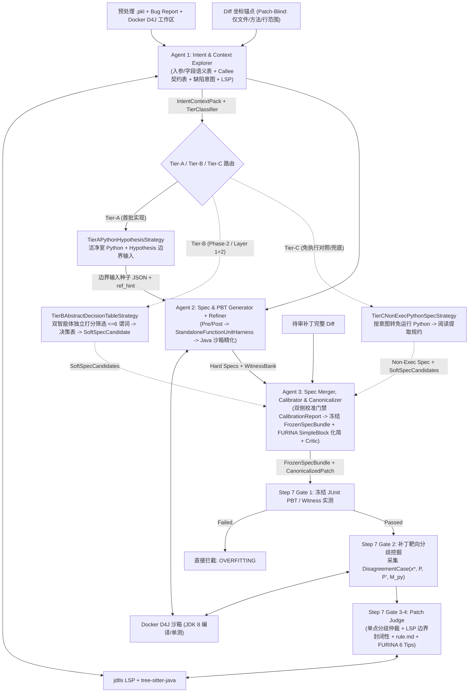

# 基于 Diff 锚定规约、PBT 精化与多智能体的补丁过拟合过滤方案（定稿实现计划）

## 1. 目标、运行环境与现有资产

本计划定稿你的研究方案工程蓝图：面向 **Linux 服务器 + Docker 容器** 环境，以 **复用三篇参考论文现有源码为第一原则**，结合预处理 `.pkl` 数据、[rule.md](file:///e:/workspace/benchmark/rule.md) 规则与 LSP 代码跳转，构建可分步交付的补丁过拟合过滤系统（`SpecPatchGuard`，项目位于 `E:\workspace\myown\SpecPatchGuard\`）。

### 1.1 运行环境与范围边界
- **最终运行形态**：部署于 **Linux 服务器**。Defects4J（D4J）缺陷项目在 **Docker 容器内完整可访问**，容器内同一份 checkout 工作区同时供 `defects4j compile/test`（JDK 8）与容器内已部署的 Eclipse `jdtls` LSP 服务（JDK 17+）访问。
- **首批验证范围**：聚焦 **Tier-A 简单/弱状态函数**（如 D4J `Lang`、`Math`、`Csv`、`Codec` 中的独立单函数缺陷），先跑通高信噪比闭环；**架构与数据契约中完整预留 Tier-B 接口**，后续可直接平滑接入 `Closure` 等重状态项目。
- **已验证可复用的本地数据与参考代码**：
  - **预处理数据**（[furina_context_data](file:///e:/workspace/Patch_Va/furina_context_data)）：`d4j_custom_function_level_patch.pkl`、`labeled_d4j20_enhance_info.pkl`、`clean_d4j20_bug_report.json`、`manifest.json`。**注意**：`.pkl` 与 `bug_report` **仅作为初始入口索引**（提供触发测试、堆栈、diff 锚点坐标与问题描述），**生成规约时绝不能只靠函数级 `.pkl` 片段，必须通过 Docker 容器内按需工具调用探索完整仓库上下文**。
  - **FURINA**（[furina-main](file:///e:/workspace/Patch_Va/furina-main/furina-main)）：[main.py](file:///e:/workspace/Patch_Va/furina-main/furina-main/main.py)、[furina_compat.py](file:///e:/workspace/Patch_Va/furina-main/furina-main/furina_compat.py)、[cofig.json](file:///e:/workspace/Patch_Va/furina-main/furina-main/cofig.json)、[PatchHelper.py](file:///e:/workspace/Patch_Va/furina-main/furina-main/util/PatchHelper.py)、[Prompt.py](file:///e:/workspace/Patch_Va/furina-main/furina-main/util/Prompt.py)、[ModelEngine.py](file:///e:/workspace/Patch_Va/furina-main/furina-main/util/ModelEngine.py)。
  - **Multi²Fixer**（[Multi-Hunk-APR](file:///e:/workspace/Patch_Va/Multi-Hunk-APR/Multi-Hunk-APR)）：[d4j.py](file:///e:/workspace/Patch_Va/Multi-Hunk-APR/Multi-Hunk-APR/d4j.py)、[tools.py](file:///e:/workspace/Patch_Va/Multi-Hunk-APR/Multi-Hunk-APR/tools.py)、[context.py](file:///e:/workspace/Patch_Va/Multi-Hunk-APR/Multi-Hunk-APR/context.py)、[prompt.py](file:///e:/workspace/Patch_Va/Multi-Hunk-APR/Multi-Hunk-APR/prompt.py) 及 `artifacts/FileParser-1.0-SNAPSHOT-jar-with-dependencies.jar`。
  - **AutoCodeSherpa**（[AutoCodeSherpa](file:///e:/workspace/Patch_Va/AutoCodeSherpa)）：[pbt-acr/app/agents/agent_reproducer.py](file:///e:/workspace/Patch_Va/AutoCodeSherpa/pbt-acr/app/agents/agent_reproducer.py)、`pbt_examples/*.py`、[agent_search.py](file:///e:/workspace/Patch_Va/AutoCodeSherpa/pbt-acr/app/agents/agent_search.py)、[explanation-audit-agent/backend.py](file:///e:/workspace/Patch_Va/AutoCodeSherpa/explanation-audit-agent/backend.py) 与 [explanation-audit-agent/tool.py](file:///e:/workspace/Patch_Va/AutoCodeSherpa/explanation-audit-agent/tool.py)。

---

## 2. 复用优先矩阵与工程目录编排

> [!IMPORTANT]
> **核心原则**：如非必要，不创造性重写代码。优先直接复用并轻量适配三篇仓库的成熟模块与书写格式（如 `furina_compat.py` 的原子写与配置校验风格、`explanation-audit-agent/backend.py` 的容器生命周期与超时处理、`pbt-acr/agent_reproducer.py` 的反馈重试循环）。

| 能力模块 | 直接复用的源文件与组件 | 增量胶水 / 必须新写的部分（Review 重点） |
| :--- | :--- | :--- |
| **配置 / `.env` / 原子落盘** | [furina_compat.py](file:///e:/workspace/Patch_Va/furina-main/furina-main/furina_compat.py)（`PlainUnpickler`、`atomic_json`、`resolve_path`、`load_settings`、`configuration_status`）+ [cofig.json](file:///e:/workspace/Patch_Va/furina-main/furina-main/cofig.json) 风格 | 扩展 `docker`、`defects4j`、`lsp`、`pipeline` 配置节 + `.env` 加载；输出 `SERVER_DEPLOY_CHECKLIST.md` 与 `doctor` 自检 |
| **预处理 `.pkl` / Bug Report / Diff 解析** | [PatchHelper.py](file:///e:/workspace/Patch_Va/furina-main/furina-main/util/PatchHelper.py)（`ExtractPatchInfo`、`FormatPatchContent`、`GetModifiedPosition`、`AttachLineNumber`）+ [main.py](file:///e:/workspace/Patch_Va/furina-main/furina-main/main.py)（`BuildFailingTestPrompt`、`BuildPatchPrompt`） | **Patch-Blind 锚点剥离器**（隐藏待审 `+` 行，仅输出原缺陷函数 + diff 行范围）+ `TierClassifier` 样本筛选 |
| **Docker + D4J 统一沙箱** | [explanation-audit-agent/backend.py](file:///e:/workspace/Patch_Va/AutoCodeSherpa/explanation-audit-agent/backend.py)（`DockerBackend`、`exec_run_with_timeout`、`switch_state`）+ [d4j.py](file:///e:/workspace/Patch_Va/Multi-Hunk-APR/Multi-Hunk-APR/d4j.py)（`checkout`、`get_bug_location`） | 容器内同一 D4J 工作区兼顾 `defects4j compile/test`（JDK 8）与 `jdtls`（JDK 17+）；注入单测后的异常安全回滚 |
| **LSP (`jdtls`) + AST 工具层** | [explanation-audit-agent/tool.py](file:///e:/workspace/Patch_Va/AutoCodeSherpa/explanation-audit-agent/tool.py)（工具封装与大文件截断规范）+ [tools.py](file:///e:/workspace/Patch_Va/Multi-Hunk-APR/Multi-Hunk-APR/tools.py)（工具 schema 风格）+ `FileParser.jar` | 容器内常驻 `jdtls` JSON-RPC 客户端（`goto_definition`、`find_references`、`type_hierarchy`、`hover`）+ `tree-sitter-java` 外层控制流提取 |
| **Tier-A 规约 + Python `Hypothesis` + Java 回灌** | [agent_reproducer.py](file:///e:/workspace/Patch_Va/AutoCodeSherpa/pbt-acr/app/agents/agent_reproducer.py)（多轮反馈历史、代码块抽取、失败重试循环）+ `pbt_examples/*.py` | Python 洁净室探索产出边界 JSON → Java 独立 JUnit 单测回灌（处理 `null`/`NaN`/溢出/转义）→ `WitnessBank` 持久化 + **预留 Tier-B 接口** |
| **规约合并 + 化简 + Judge** | [Prompt.py](file:///e:/workspace/Patch_Va/furina-main/furina-main/util/Prompt.py)（`Profiler`、`Interpreter <SimpleBlock>`、`Critic`、`Judge` 6 条 Tips）+ `ExtractLabelContainer` + [rule.md](file:///e:/workspace/benchmark/rule.md) | 合并规约冲突消解 + 适配无开发者补丁版 [rule.md](file:///e:/workspace/benchmark/rule.md) + LLM 输出漂移容错解析 |

### 2.1 工程目录编排规范（参考三篇论文分层架构）

参考 `AutoCodeSherpa/pbt-acr`（`app/{agents,analysis,api,model,search}/`、`conf/`、`test/`）、`FURINA`（`util/`、`llm_judge_prompts/`）与 `Multi-Hunk-APR`（`secbench_multifixer/`）的分层包结构，项目统一落地在 **`E:\workspace\myown\SpecPatchGuard\`**，**禁止将不同职责的 `.py` 文件扁平堆砌在根目录**；所有单测镜像在 `tests/<layer>/` 下：

```text
E:\workspace\myown\SpecPatchGuard\
├── .env.example
├── .gitignore
├── pytest.ini
├── SERVER_DEPLOY_CHECKLIST.md
├── config/
│   ├── config.json                 # 8 节服务器配置（data/api/docker/defects4j/lsp/tools/output/pipeline）
│   └── llm_config.json             # 通用 LLM 配置（多模型 profile、max_tokens、思考/reasoning 支持、角色路由）
├── specpatchguard/
│   ├── __init__.py
│   ├── __main__.py                 # 统一 CLI 入口：python -m specpatchguard <subcmd>
│   ├── core/                       # Step 1：配置加载、通用 LLM 配置、.env、原子落盘、doctor 自检
│   │   ├── __init__.py
│   │   ├── config_loader.py
│   │   ├── llm_config.py
│   │   └── doctor.py
│   ├── data/                       # Step 2：.pkl 加载、Patch-Blind 剥离、Schema、Tier 路由器
│   ├── sandbox/                    # Step 3：Docker + D4J 统一后端、单测注入与工作区回滚
│   ├── analysis/                   # Step 4：Docker 内 jdtls LSP + 可配 context grep/read + 分支/类成员/符号追踪
│   │   ├── __init__.py
│   │   ├── protocols.py
│   │   ├── lsp_client.py
│   │   ├── repo_tools.py
│   │   ├── ast_context.py
│   │   └── tool_registry.py
│   ├── strategies/                 # Step 5：CrossRepStrategy / TestHarnessStrategy（实装 Tier-A，预留 Tier-B）
│   ├── agents/                     # Step 5–7：Intent/PBT/Merger/Judge 多智能体编排
│   ├── prompts/                    # Step 5–7：FURINA/Multi2Fixer/rule.md 提示词模板与改编规则
│   └── pipeline/                   # Step 7：端到端流水线调度与评测汇总
└── tests/
    ├── core/                       # Step 1 单测
    ├── data/                       # Step 2 单测
    ├── sandbox/                    # Step 3 单测
    ├── analysis/                   # Step 4 单测
    ├── strategies/                 # Step 5 跨语言与 Harness 单测
    ├── agents/                     # Step 5–7 Agent 单测
    └── pipeline/                   # Step 7 集成评测单测
```

### 2.2 Docker 容器内按需工具集规范（LSP 跳转 + 可配 Context Grep + 条件分支与类属性）

在 **Agent 1（Intent/Context Explorer）** 与 **Agent 2（Spec/PBT Generator）** 阶段，严禁仅依赖预处理 `.pkl` 的单函数文本生成规约；所有工具均**直接运行在 Docker 容器内的缺陷工作区中**（提取规约阶段强制锁定 **`readonly_prepatch`** 状态以保持 Patch-Blind 隔离，Agent 4 Judge 阶段才允许切换到 `postpatch` 做核验），由 LLM 按需调用：

| 工具类别 | 工具名（`tool_registry.py`） | 关键参数（含上下文控制） | 返回内容与用途 |
| :--- | :--- | :--- | :--- |
| **Docker 内 LSP 跳转**（`lsp_client.py`） | `lsp_goto_definition`<br>`lsp_find_references`<br>`lsp_hover`<br>`lsp_type_hierarchy` | `file_path`, `line`, `character`, `scope`, `exclude_tests`, `context_lines`（可选，返回目标位置前后源码行数） | 跨文件/跨包跳转方法、字段、类型与常量定义（`rule.md` 等价 3/7）；查全库引用与可达生产调用点（`exclude_tests=True` 过滤测试，对应边界 1/2/3 与等价 8）；读取 Javadoc/签名与子类重写链（过拟合 6） |
| **Docker 内可配 Context 检索与读文件**（`repo_tools.py`） | `grep_code` | `pattern`, `path_glob`, `context_before`, `context_after`, `context_lines`（统一前后行数，受 `tools.grep_max_context_lines` 上限约束）, `max_matches`, `case_sensitive` | 在容器仓库内执行 `rg`/`grep`，带行号与可调上下文窗口（默认前后各 5 行，可按需调大）定位相关调用者、常量、全局配置或异常抛出点 |
| **Docker 内精准读行**（`repo_tools.py`） | `read_file_lines` | `file_path`, `start_line`, `end_line`, `context_before`, `context_after` | 读取指定行区间及前后扩展上下文（受 `tools.read_max_lines` 与 `max_tool_output_chars` 截断保护） |
| **Docker 内条件分支、类属性与符号追踪**（`ast_context.py`） | `get_enclosing_branches`<br>`get_class_members`<br>`get_method_context`<br>`trace_symbol_usage` | `file_path`, `line` / `class_name` / `method_name` / `symbol_name`, `context_before`, `context_after`, `context_lines`, `include_fields`, `include_constructors`, `include_methods`, `max_matches` | 1) 提取锚点行外层嵌套 `if / else / switch / for / while / try-catch` 条件链、前置 early-return 守卫、后续语句预览及类/方法可见性；<br>2) 提取所在类可见性、继承关系、全部字段属性、修饰符、初始值、构造器与方法签名；<br>3) 提取目标方法完整体、同名重载列表及前后自定义扩展行；<br>4) 追踪类字段/全局配置/入参/返回值的读/写/调用足迹（对应 `rule.md` 等价 7 与边界 1/2/3） |

---

## 3. 服务器配置外置、LSP 假设与防遗忘规范

### 3.1 `.env` 与 `config/config.json` 结构规范
所有服务器路径、容器镜像、LSP 二进制路径、API 密钥与实验开关一律从外部配置读取，代码内**零硬编码服务器路径**：

- **`.env`**（位于项目根目录或 `config/` 目录，由 `.env.example` 模板生成，不入库）：
  ```dotenv
  OPENAI_API_KEY=sk-...
  OPENAI_API_BASE=https://...
  LLM_MODEL=deepseek-chat
  ```
- **`config/config.json`**（延续 [cofig.json](file:///e:/workspace/Patch_Va/furina-main/furina-main/cofig.json) 风格并扩展为 8 节）：
  ```json
  {
    "data": {
      "patch_info_pkl": "../../../Patch_Va/furina_context_data/d4j_custom_function_level_patch.pkl",
      "test_info_pkl": "../../../Patch_Va/furina_context_data/labeled_d4j20_enhance_info.pkl",
      "bug_report_json": "../../../Patch_Va/furina_context_data/clean_d4j20_bug_report.json",
      "manifest_json": "../../../Patch_Va/furina_context_data/manifest.json",
      "rule_md_path": "../../../benchmark/rule.md"
    },
    "api": {
      "base_url_env": "OPENAI_API_BASE",
      "api_key_env": "OPENAI_API_KEY",
      "model_env": "LLM_MODEL",
      "llm_config_path": "./llm_config.json",
      "temperature": 0.0,
      "max_tokens": 8192,
      "timeout_seconds": 900,
      "max_retries": 2
    },
    "docker": {
      "image_name": "d4j-lsp-runtime:latest",
      "container_work_root": "/workspace/d4j_work",
      "host_mount_root": "/data/patch_va/d4j_work",
      "timeout_seconds": 900,
      "nano_cpus": 8000000000
    },
    "defects4j": {
      "d4j_home": "/data/public/defects4j",
      "java8_home": "/workspace/envs/defects4j",
      "compile_timeout_sec": 900,
      "test_timeout_sec": 900
    },
    "lsp": {
      "enabled": true,
      "mode": "docker_jdtls",
      "jdtls_home": "/opt/jdtls",
      "jdtls_java_home": "/opt/jdk-17",
      "jdtls_config_dir": "/opt/jdtls/config_linux",
      "jdtls_workspace_cache": "/tmp/jdtls_ws_cache",
      "init_timeout_sec": 900,
      "request_timeout_sec": 900
    },
    "tools": {
      "grep_default_context_before": 5,
      "grep_default_context_after": 5,
      "grep_max_context_lines": 50,
      "grep_max_matches": 30,
      "read_default_context_before": 10,
      "read_default_context_after": 10,
      "read_max_lines": 200,
      "branch_context_lines": 3,
      "max_tool_calls_per_agent": 15,
      "max_tool_output_chars": 24000,
      "command_timeout_sec": 900
    },
    "output": {
      "result_dir": "../SpecPatchGuard_result",
      "spec_cache_dir": "../SpecPatchGuard_result/frozen_specs",
      "resume": true
    },
    "pipeline": {
      "target_tier": "tier_a",
      "enable_cross_rep_tier_a": true,
      "enable_cross_rep_tier_b": false,
      "enable_anchor_infection_probes": true,
      "pbt_refine_max_rounds": 5,
      "syntax_fix_max_rounds": 3,
      "hypothesis_max_examples": 100
    }
  }
  ```

### 3.2 防遗忘代码标记 & 部署清单
1. **代码标记规范**：凡是必须依赖外部部署路径、环境变量或读取模板位置的地方，必须在代码旁强制加上统一注释标记：
   ```python
   # [SERVER_CONFIG_REQUIRED]: 确认服务器 config/config.json -> lsp.jdtls_home 与 lsp.jdtls_java_home 指向有效路径
   ```
   后续可通过一条 `rg "SERVER_CONFIG_REQUIRED" specpatchguard/` 扫描全库所有待核对点。
2. **独立部署清单 `SERVER_DEPLOY_CHECKLIST.md`**：随 Step 1 一并生成，逐条对照列出上传服务器后需修改的配置键、Docker 挂载路径映射、`jdtls` 与 JDK 8 / JDK 17+ 分离检查、以及 `python -m specpatchguard doctor` 一键自检命令。

---

## 4. Tier-A 机制与 Tier-B 预留接口设计

为保证首批聚焦 Tier-A 简单函数时结构简洁，同时**未来接入 Tier-B（如 `Closure`）时无需推翻重来**，在核心架构与 `specpatchguard/data/schemas.py`、`specpatchguard/strategies/protocols.py` 中明确定义以下两套扩展协议（`Protocol`）与预留字段：

### 4.1 两种策略的职责划分
- **Tier-A（首批实现，纯算法 / 弱状态单函数）**：
  1. **基于结构化意图的洁净室 Python 参考模型 + `Hypothesis` 孵化边界输入**：Agent 2 与 Cross-Rep 消费 Agent 1 显式沉淀的三张结构化语义表（`parameter_field_semantics`、`callee_contracts`、`structured_defect_intent`）以及 Java 方法签名 / Javadoc，做到**按意图建模（intent-driven modeling）**而非逐行硬翻；写 Python 参考实现并跑 `Hypothesis`，导出**具体边界输入 JSON**（不采信 Python 返回值作最终 Oracle）。
  2. **回灌 Java D4J 沙箱实跑 + Level 2 独立单测**：将原生 PBT 与 Python 孵化的输入一起填入针对该缺陷函数的**独立 JUnit 单元测试**（Precondition → 参数过滤，Postcondition → 返回值/异常强断言，外加锚点行只读 `InfectionProbe` 探针），在服务器容器内原缺陷 Java 代码 $P$ 上真跑：
     - 稳定复现目标失败的输入 → **`confirmed_bug_witnesses`**；
     - 在缺陷版合法通过的边界输入（连同缺陷版真实输出快照） → **`boundary_passing_witnesses`**；
     - 无关异常/非法输入 → **`excluded_irrelevant_cases`**（并收窄 $I$）。
- **Tier-B（重状态 / 框架耦合如 `Closure`，分 Layer 1 与 Layer 2 渐进落地）**：
  - **Layer 1 — `TierBAbstractDecisionTableStrategy`（结构化软规约，无需编译运行 Java）**：基于 Agent 1 的结构化语义表与 diff 所在短方法，由**两个独立 LLM 智能体**分别提名候选谓词，等价归一化后按“每名智能体选中 +1 分”累加总分并排序，**硬性限定最多只保留 `<= 6` 个谓词**（$|P| \le 6$，组合上限 $2^6 = 64$）。在此谓词空间上构建 20–50 行 Python 抽象决策表 / JSON 真值表，穷举全部 $2^{|P|}$ 组合提取分歧谓词行 $\vec{p}^*$，产出低权重 **`SoftSpecCandidate`**（无一票否决权）供 Judge 做单条件仲裁。
  - **Layer 2 — `PublicEntryAnchorProbeHarness`（Phase-2 可执行实证层）**：复用原 `trigger_test` 公共入口骨架（`entry_harness_skeleton`），在 $\vec{p}^*$ 引导下对高层面领域输入（如 JS/JSON/HTML/CLI 字符串）做变异（避免强行单拎 `private` 方法造出非法 Mock 对象），并在 diff 锚点行挂载 `ReadOnlyAnchorProbeInjector` 只读探针验证可达性与感染条件 $F_L$；若公共入口编译失败或未击中锚点，则自动回退到 Layer 1。
  - **Phase-1 优雅延迟交接（`tier_b_placeholder`）**：在 Phase-2 Tier-B 策略尚未启用、Step 5 返回 `status="tier_b_placeholder"` 时，Step 6 跳过可执行双侧校准并输出带 `tier_b_deferred` 标记的 `FrozenSpecBundle`，Step 7 自动跳过 Gate 1/2 直通 Gate 3/4 语义仲裁，绝不因空 `WitnessBank` 报错中断。
- **Tier-C（免执行意图转 Python 阅读提规约策略，用于重型兜底与核心消融对照）**：
  - `TierCNonExecPythonSpecStrategy`（实现 `CrossRepStrategy`，**不运行 Python、不编译 JUnit Harness**）：在完整消费 Agent 1 的三张结构化语义表（`structured_defect_intent` 意图、`parameter_field_semantics` 输入/字段含义、`callee_contracts` 内部调用函数含义）及 Patch-Blind 原缺陷类方法后，**按自然语言意图将原始缺陷类方法转换为高可读的 Python 语义参考代码（`python_intent_code`）**；**严禁执行该 Python 代码**，而是直接通过独立的 Spec Reader LLM 通读这份 Python 代码来抽取结构化规约（`PrePostSpec` + `SoftSpecCandidate(source="tier_c_nonexec_python")`）。
  - **下游衔接**：Step 6 强制标记 `CalibrationReport(calibrated=False, reason="tier_c_non_executable")` 与 `tier_c_non_exec` 冻结模式；Step 7 跳过依赖执行的 PBT 扩展见证与 Python 分歧挖掘（Gate 1 仅可按配置执行原 D4J `trigger_tests` 回归），直接携 Tier-C 抽取规约 + `<SimpleBlock>` + LSP + `rule.md` 进入 Gate 3/4 语义仲裁。

### 4.2 预留接口与 Schema 契约（Python `Protocol` + `dataclass`）

```python
from typing import Literal, Protocol, Any
from dataclasses import dataclass, field

TierType = Literal["tier_a", "tier_b", "tier_c"]  # 默认自动路由仍为 tier_a / tier_b；tier_c 需显式启用或降级触发

class TierClassifier(Protocol):
    """根据方法签名、修饰符及 AST 外部依赖自动判定 Tier-A / Tier-B（或显式启用 Tier-C）。"""
    def classify(self, intent_pack: "IntentContextPack") -> TierType: ...

class CrossRepStrategy(Protocol):
    """跨表达参考建模统一接口：Tier-A 实装 Python+Hypothesis，Tier-B 预留抽象决策表，Tier-C 预留免执行意图转 Python 提规约。"""
    tier: TierType
    def generate_candidates(
        self, intent_pack: "IntentContextPack", config: dict[str, Any]
    ) -> "CrossRepResult": ...

class TestHarnessStrategy(Protocol):
    """JUnit 沙箱测试骨架统一接口：
    - Tier-A 使用 StandaloneFunctionUnitHarness（单拎函数做 JUnit 单测 + 可选锚点探针）
    - Tier-B 预留 PublicEntryAnchorProbeHarness（复用 trigger_test 公共入口 + 锚点探针）
    """
    tier: TierType
    def build_junit_source(
        self, pre_post: "PrePostSpec", candidate_inputs: list[dict[str, Any]],
        intent_pack: "IntentContextPack"
    ) -> str: ...
    def parse_execution_result(self, raw_result: dict[str, Any]) -> "HarnessRunResult": ...
```

- **Schema 预留字段（零破坏性扩展）**：
  - `IntentContextPack`：`tier: TierType`、`entry_harness_skeleton: str`、`boundary_context: BoundaryContext`；以及向后兼容新增的三张显式结构化语义字段（默认空集合，确保 Step 1–5 既有单测零破坏）：
    - `parameter_field_semantics: list[dict[str, Any]] = field(default_factory=list)`（入参 / 类字段 / 返回值语义表）
    - `callee_contracts: list[dict[str, Any]] = field(default_factory=list)`（直接调用 Callee 函数契约表）
    - `structured_defect_intent: dict[str, Any] = field(default_factory=dict)`（缺陷报告与失败测试意图结构化摘要）
  - `WitnessBank`：`confirmed_bug_witnesses`、`boundary_passing_witnesses`、`excluded_irrelevant_cases`、`infection_probe_traces: list[dict]`（Tier-A 可先记录命中与关键变量快照，Tier-B 直接复用）
  - `FrozenSpecBundle`：`hard_specs: PrePostSpec`、`witness_bank: WitnessBank`、`soft_spec_candidates: list[SoftSpecCandidate]`（Tier-A 模式下默认空或仅作互补提示，Tier-B/Tier-C 模式直接填充）、`calibration_report: CalibrationReport | None = None`（Step 6 双侧校准报告，默认 `None` 兼容已有单测）
  - `JudgeVerdict`：`verdict`（`CORRECT` / `OVERFITTING` / `UNCERTAIN`）、`failed_gates`、`witness_evidence`、`lsp_evidence`、`soft_spec_findings: list[dict]`、`disagreement_cases: list[DisagreementCase] = field(default_factory=list)`（Step 7 单点分歧仲裁证据）、`rationale`
  - **可选 `pipeline` 配置键（统一通过 `settings.pipeline.get(..., default)` 安全读取）**：`max_tier_b_predicates`（默认且硬上限为 `6`）、`tier_b_predicate_proposers`（默认 `2`，即双独立谓词提名智能体）、`enable_tier_c_nonexec_python`（默认 `false`），同时 `target_tier` 支持 `"tier_a" | "tier_b" | "tier_c"` 用于可控消融或重型兜底运行。

### 4.3 核心创新升级：双侧校准 + 补丁靶向分歧挖掘 + 单点仲裁（Propose Disagreement, Then Arbitrate）

> [!IMPORTANT]
> **核心方法论原则**：在没有真实开发者补丁的前提下，**绝不把 Java→Python 洁净室重写输出当作 100% 绝对真值（Sole Oracle），更不允许 Python 直接一票否决 Java 补丁**。系统严格区分“100% 确定性真值”与“概率型跨表达代理（Proxy）”，将 Python 模型降维为**分歧反例挖掘器**，由后续单点仲裁消除跨语言语义偏差导致的误杀（FN）。

1. **三阶段闭环设计（零返工衔接已完成的 Step 5 数据）**：
   - **Stage A — 双侧校准门禁（`CalibrationReport`，归属 Step 6）**：
     - 直接复用 Step 5 已落盘的 `WitnessCase.metadata["ref_hint"]`（Python 预测提示）、`WitnessCase.observed_buggy_outcome`（原缺陷 Java `P` 的真实运行输出）、`CrossRepResult.python_model_code` 与原始触发测试（F2P）期望，**无需修改 Step 5 代码**。
     - **正常侧一致率（`passing_agreement_rate`）**：统计所有合法通过样本（`boundary_passing_witnesses`）中 `ref_hint` 与 `observed_buggy_outcome` 语义一致的比例（要求样本数 `>= calibration_min_passing_samples`，默认 `2`，一致率 `>= calibration_min_passing_agreement`，默认 `0.8`）。
     - **缺陷侧对齐度（`bug_side_aligned`）**：核验在已知 F2P / `confirmed_bug_witnesses` 输入上，Python 模型是否确实绕过了原 Java 缺陷（未触发原异常或输出符合预期方向）。
     - **门禁决策**：仅当双侧校准均通过时置 `calibrated=True`；否则自动降级为 `calibrated=False`，**禁止后续启用 Python 作为分歧参照**。
   - **Stage B — 补丁靶向分歧挖掘（`DisagreementCase`，归属 Step 7 Gate 2）**：
     - 对于通过 Gate 1 冻结 PBT/Witness 实测的待审补丁，不再仅靠随机采样，而是分析其 `<SimpleBlock>` 化简后新增的**分支条件、硬编码常量、提前 `return` 路径**，定向生成 `max_disagreement_probes`（默认 `5`）个靶向边界输入 $x^*$。
     - 在沙箱中分别采集真实执行输出 $P(x^*)$（缺陷版）、$P'(x^*)$（待审补丁版），若 `calibrated=True` 则同步运行 `python_model_code` 得到 $M_{\text{py}}(x^*)$；凡出现 $P'(x^*) \neq M_{\text{py}}(x^*)$ 或在非缺陷邻域 $P'(x^*) \neq P(x^*)$ 时，生成结构化 `DisagreementCase`。
   - **Stage C — 单点分歧仲裁（Single-Input Arbitrator，归属 Step 7 Gate 3/4）**：
     - Judge 不再空泛猜测“补丁是否有漏洞”，而是针对每一条 `DisagreementCase(x*, P(x*), P'(x*), M_py(x*))`，严格对照原 Javadoc、Bug Report 与 Trigger Test 做聚焦单点裁决，输出三选一结论：
       1. `patch_overfitting`：对当前具体输入 $x^*$，待审补丁 $P'(x^*)$ 确实违背契约（可作强证伪依据）；
       2. `python_semantic_gap`：分歧源于 Java/Python 语义差异（如 32 位整型溢出、浮点精度、`null` vs `None`、`>>>` 等）或 Python 模型自身疏漏，**放行且不计入过拟合惩罚**；
       3. `inconclusive`：信息不足以单点裁决，转由 LSP 边界封闭性与 `rule.md` 红线综合判定。

2. **向后兼容的数据契约与配置约定（Step 6/7 增量扩展）**：
   - 在 `specpatchguard/data/schemas.py` 中新增默认向后兼容数据结构：
     - `CalibrationReport(calibrated: bool = False, passing_checked: int = 0, passing_agreed: int = 0, passing_agreement_rate: float = 0.0, bug_checked: int = 0, bug_aligned: int = 0, bug_side_aligned: bool = False, reason: str = "", details: list[dict[str, Any]] = field(default_factory=list))`
     - `DisagreementCase(case_id: str, input_args: list[Any], target_patch_branch: str, buggy_output: str, patched_output: str, python_proxy_output: str | None = None, probe_source: str = "patch_targeted", arbitration_verdict: Literal["pending", "patch_overfitting", "python_semantic_gap", "inconclusive"] = "pending", arbitration_rationale: str = "")`
   - `pipeline` 新增可选键（在 Step 6/7 中通过 `settings.pipeline.get(..., default)` 安全读取，不破坏 Step 1 既有 `config_loader.py` 严格校验，或在同步更新配置模板与单测后再写入）：`calibration_min_passing_agreement`（`0.8`）、`calibration_min_passing_samples`（`2`）、`enable_patch_targeted_disagreement`（`true`）、`max_disagreement_probes`（`5`）。

### 4.4 Step 6–7 关键衔接契约与防误杀细则

1. **非崩溃型语义缺陷防误杀分流（Step 6 冻结 `FrozenSpecBundle` 时必做）**：
   - 在 Step 5 中，Cross-Rep 候选输入仅带 `ref_hint`、不带 `expected_return`/`java_assertion`；对于“不抛异常、但返回错误值”的语义缺陷（如 `Math-5` 返回 `NaN`），原缺陷代码 `P` 也会在 Harness 中被暂归入 `boundary_passing_witnesses`。若直接拿它们在 Gate 1 强制要求 `P'(x) == P(x)`，会误杀修对返回值的正确补丁。
   - **Step 6 强制分流规则**：在 `FrozenSpecBundle` 中将通过见证细分为两层（通过 `WitnessCase.metadata["passing_tier"]` 或对应冻结列表区分）：
     - **`verified_passing_witnesses`（高置信回归基线）**：仅保留 `category != "bug_trigger"` 且（若有 `ref_hint`）与原缺陷 Java `observed_buggy_outcome` 一致、或经确认属于非缺陷正常域的样本；**只有此子集允许进入 Gate 1 强制 `P'(x) == P(x)` 回归断言**。
     - **`unverified_or_mismatched_passing`（存疑/疑似语义缺陷样本）**：在缺陷版 `P` 未抛异常但 `observed_buggy_outcome != ref_hint` 或 `category == "bug_trigger"` 的样本；**严禁作为 Gate 1 回归基线拦截补丁**，自动转入 Gate 2/3 作为候选 `DisagreementCase` 参与单点仲裁。

2. **冻结验证测试重建（`FrozenValidationTest.java`，Step 6/7）**：
   - 不直接复用 Step 5 精化中间态的 `SpecRefinementResult.junit_source` 作为最终裁判；必须基于冻结后的 `FrozenSpecBundle` 重新渲染干净的 **`FrozenValidationTest.java`** 供 Step 7 Gate 1 在 `postpatch` 上执行：
     - 彻底剔除 `excluded_irrelevant_cases` 与 `unverified_or_mismatched_passing`；
     - `confirmed_bug_witnesses` 生成强后置断言 / 无原缺陷异常检查；
     - `verified_passing_witnesses` 自动将缺陷版 `P` 的 `observed_buggy_outcome` 固化为回归 `assertEquals` 断言。

3. **`FrozenSpecBundle` 缓存粒度键与多层级复用体系**：
   - 规约冻结层缓存键规定为 **`(bug_id, canonical_anchor_methods_hash, effective_tier)`**（对目标修改方法签名列表排序后取 12 位短哈希，并带上 `effective_tier` 以防止 Tier-A / Tier-B / Tier-C 消融互相串缓存），而非仅按 `bug_id`。
   - 修改同一组方法且同一 Tier 的候选补丁完全复用同一份 `FrozenSpecBundle`；若同一缺陷的不同补丁改在不同方法（例如 `caller` vs `callee`，对应 `rule.md` 等价第 8 条），共享 `BugReport` 与触发测试（`d4j_meta`），但独立生成锚点与边界规约，防止张冠李戴。
   - **完整的多层文件级“存在即复用”路径、共享 Key 计算器与防脏缓存规则见下文 Section 4.7**。

4. **Step 7 Gate 2 `python_model_code` 单输入求值协议**：
   - 复用 Step 5 已约定的洁净室入口函数 **`ref_impl(*args)`**（[pbt_prompts.py](file:///E:/workspace/myown/SpecPatchGuard/specpatchguard/prompts/pbt_prompts.py) 已强制规范）。
   - 通过独立安全子进程包装器（复用 Step 5 `validate_clean_room_python` AST 白名单 + 清洗环境变量 + `python -B` + 超时控制）加载 `python_model_code`，还原 `{"__spg_float__": ...}` 特殊浮点参数后调用 `ref_impl(*args)` 获取 `M_py(x*)`；若 `ref_impl` 缺失、参数 arity 不匹配或运行报错，显式记 `python_proxy_output = None` 降级，绝不中断主流程。

5. **Step 7 终审聚合优先级与 `UNCERTAIN` 评测口径**：
   - **Gate 1 短路规则**：补丁编译失败 / 原 `trigger_tests` 失败 / `relevant_tests` 失败 / `confirmed_bug_witnesses` 失败 / `verified_passing_witnesses` 回归破坏 → 直接短路判 `OVERFITTING`（`prediction = 0`），跳过后续 LLM 成本。
   - **Gate 2–4 聚合规则**：存在 `>= 1` 条单点仲裁为 `patch_overfitting` 的 `DisagreementCase`，或命中 `rule.md` 硬红线 / LSP 边界封闭性硬违背 → 判 `OVERFITTING`（`prediction = 0`）；若所有分歧均被仲裁为 `python_semantic_gap` 且红线全通过 → 结合 `<SimpleBlock>` 化简与 FURINA 6 Tips 判 `CORRECT`（`prediction = 1`）；证据不足或降级无法裁决 → 判 `UNCERTAIN`。
   - **`UNCERTAIN` 二分类评测口径（`eval_metrics.py`）**：计算标准二分类 `Accuracy/Precision/Recall/F1` 时默认按保守策略映射 **`UNCERTAIN -> 0 (OVERFITTING)`**，同时**强制额外输出** `uncertain_count`、`uncertain_rate` 及 `decided_only` 子集指标。

### 4.5 全链路英文分析与输出硬约束（English-Only LLM Policy）

- **已完成步骤（Step 1–5）中文审计结果**：
  - `specpatchguard/prompts/{intent_prompts.py,pbt_prompts.py}`、`agents/`、`strategies/`、`data/`、`sandbox/` 及 `analysis/tool_registry.py` 中 **LLM Prompt 与运行时输出均为 100% 纯英文，无任何中文**。
  - 全库仅 `core/{config_loader.py,doctor.py,llm_config.py}` 与 `analysis/{ast_context.py,lsp_client.py,protocols.py}` 存在 14 行内部开发者注释（`# [SERVER_CONFIG_REQUIRED]`）或代码 docstring，均不会发送给 LLM。
- **全过程纯英文硬规定（Step 5–7 均须遵守）**：
  1. **Prompt 与输出语言约束**：所有 LLM 提示词（Agent 1–4、Cross-Rep、Disagreement Miner、Single-Input Arbitrator）必须 100% 使用英文编写，且**在系统/输出指令中显式加上强制英文约束**：`"Write ALL reasoning, analysis, summaries, notes, rationales, and JSON string values strictly in English."`（防止 DeepSeek/Qwen 等模型输出漂移成中文；Step 6/7 新建提示词严格内置，后续可顺带补入 Step 5 提示词）。
  2. **`benchmark/rule.md` 英文结构化转写**：因原 [rule.md](file:///e:/workspace/benchmark/rule.md) 为中文，Step 7 `specpatchguard/prompts/adapted_rules.py` **严禁直接拼接中文 `rule.md` 原文喂给 LLM**，必须将 10 等价 + 6 过拟合 + 3 边界全部转写为精炼结构化英文规则条款。
  3. **单测防中文回归门禁**：Step 6/7 单测必须包含正则校验，断言渲染后的全部 LLM Prompt 与规则模板中不含 CJK 字符（`re.search(r"[\u4e00-\u9fff]", prompt) is None`）。

### 4.6 Agent 1 显式结构化语义沉淀与 Tier-B 双智能体谓词筛选规范

#### 4.6.1 Agent 1 显式结构化语义契约沉淀（Intent-Driven Modeling Foundation）
Agent 1 的核心价值不只是输出一段泛泛的 `bug_intent_summary`，而是借助 Docker 内 AST/LSP 工具**显式结构化沉淀完整的“方法级设计意图 + 方法内全部关键变量含义 + Callee 契约 + 缺陷/测试意图”**并存入 `IntentContextPack`，让下游 Tier-A / Tier-B / Tier-C 真正具备足够上下文做到**“按意图建模（Intent-Driven Modeling）”而非“逐行硬翻 Java”**：
1. **入参 / 类字段 / 内部局部变量 / 返回值语义表（`parameter_field_semantics`）**：
   - 借助 `get_class_members`、`trace_symbol_usage`、`lsp_hover` 与完整缺陷方法体提取并结构化记录每一项符号：`{name, kind ("param" | "field" | "local_var" | "return"), java_type, semantic_role, valid_domain_or_invariants, nullable_or_edge_cases}`。
   - **必须涵盖方法体内部关键局部变量与状态标志（`local_var`）**（如游标索引、状态布尔位、临时缓冲集合等），不得遗漏。
2. **Callee 函数契约表（`callee_contracts`）**：
   - 借助 `lsp_goto_definition` 与 `read_file_lines` 查明锚点方法内关键被调 helper 的真实契约：`{callee_signature, resolved_location, precondition, return_semantics, side_effects, exception_behavior}`，使下游 Cross-Rep / PBT / 决策表 / Tier-C 无需盲猜或硬内联重型 Callee 实现。
3. **缺陷报告与测试意图结构化摘要（`structured_defect_intent`）**：
   - 结合 `bug_intent_summary` 完整记录**目标方法整体设计职责**（不仅停留在表面失败现象），并结构化拆分为 `{bug_report_claims, failing_test_assertions, trigger_conditions, expected_postcondition_summary, bug_report_available}`，严格区分“权威失败测试契约”与“Bug Report 症状线索”。
- **向后兼容增量落地方式**：保留 `IntentContextPack` 既有字段不变，在 `schemas.py`（归属 Step 2）中以空列表/空字典默认值新增上述 3 个字段；在 `intent_prompts.py`（严格遵守 Section 4.5 纯英文约束）与 `intent_agent.py`（归属 Step 5）中引导 Agent 1 显式输出并在解析缺失时安全降级为空结构；下游 `pbt_prompts.py`（Tier-A）、`TierBAbstractDecisionTableStrategy`（Tier-B）与 `TierCNonExecPythonSpecStrategy`（Tier-C）直接消费这三张表进行意图建模。

#### 4.6.2 Tier-B 谓词空间硬约束（≤ 6 谓词）与双智能体独立打分排名筛选
为防止复杂/重状态方法在抽象建模时出现谓词爆炸、无关噪声分支干扰或单模型偏见，Tier-B 强制执行**显式硬上限 + 双智能体独立投票排序**：
1. **谓词上限硬声明与代码强约束（`MAX_TIER_B_PREDICATES = 6`）**：
   - 在 Prompt 指令与程序校验中**显式声明：Tier-B 最多只能选择 `6` 个谓词**（$|P| \le 6$，保证全组合上限为 $2^6 = 64$ 个状态格），绝不允许无限膨胀。
2. **双智能体独立提名（Dual-Agent Independent Proposal）**：
   - 启动**两个相互独立的 LLM 智能体**（`Proposer A` 与 `Proposer B`，各自隔离上下文、互不可见对方推理过程，消除锚定偏差；可通过 `llm_config.json` 的 `role_overrides` 路由至不同模型或同模型两次独立采样，Prompt 与输出严格遵守 Section 4.5 纯英文约束）。
   - 每个智能体读取 `IntentContextPack`（上述三张结构化语义表 + Patch-Blind 原缺陷锚点方法），独立输出候选谓词清单：`{predicate_id, canonical_expr, java_probe_expr, description, local_rank, anchor_relevant}`。
3. **等价归一化、逐项计分与全局排名筛选**：
   - **规范化去重**：对双智能体提名的谓词表达式进行语法/语义归一化（如空白规整、`null == x` 统一为 `x == null`、布尔条件规范对齐）合并等价项；
   - **独立计分（+1 分制）**：每有一名 LLM 智能体选出该谓词即记 **1 分**，累加总分（两名智能体均选中得 **2 分** 共识优先；仅一名选中得 **1 分**）；
   - **确定性平局裁决与 Top-6 截断**：按总分降序排列；同分时依次按（a）双侧 `local_rank` 综合排名更靠前、（b）直接位于 diff 锚点或异常栈条件分支（`anchor_relevant=True`）、（c）`java_probe_expr` 通过只读探针校验（`_validate_readonly_java_expr`）作为确定性平局裁决条件；最终**严格截断保留前 `<= 6` 个谓词**。
4. **Layer 1 → Layer 2 渐进执行与回退**：
   - **Layer 1（结构化抽象决策表）**：仅基于筛选后的 $\le 6$ 个谓词生成 20–50 行 Python 抽象决策表 / JSON 真值表，穷举全部 $2^{|P|}$ 组合算出预期与补丁行为分歧格 $\vec{p}^*$，输出低权重 `SoftSpecCandidate`（无一票否决权）引导 Judge 做单条件仲裁；
   - **Layer 2（Phase-2 公共入口实证）**：由 `PublicEntryAnchorProbeHarness` 在 $\vec{p}^*$ 引导下变异 `entry_harness_skeleton` 的高层面领域输入，并挂接 `ReadOnlyAnchorProbeInjector` 探针在 JVM 实跑验证锚点可达性与状态；若编译失败或未触发锚点，则自动安全回退到 Layer 1 结论。

#### 4.6.3 Tier-C 策略：意图驱动免执行 Python 重写与阅读提规约（Non-Executable Intent-to-Python Spec Extraction）
面向“重型对象难以直接跑通”或需要独立对比“跨语言语义中转是否带来规约质量净收益”的消融/兜底场景，新增 **Tier-C（`TierCNonExecPythonSpecStrategy`）**——**只把意图驱动转换后的 Python 代码作为可读中间语义表示，绝不运行该 Python 代码，直接通过通读这份 Python 代码抽取规约**：
1. **Step C1 — 结构化意图输入（严格 Patch-Blind）**：
   - 输入 `IntentContextPack` 的三张结构化语义表（`structured_defect_intent` 意图、`parameter_field_semantics` 输入/字段含义、`callee_contracts` 内部被调函数契约）以及原缺陷类方法源码（严禁透传待审补丁 `+` 行）。
2. **Step C2 — 按自然语言意图转换为免运行 Python 语义代码（`python_intent_code`）**：
   - 由 LLM 在充分理解方法意图、入参/类字段含义与 Callee 函数契约后，将原始缺陷类方法转换为结构清晰、变量/语义显式化的 Python 语义参考代码（`python_intent_code`）。
   - 遇到外部复杂 Java 对象或重型 Callee 时，直接按其契约以抽象调用或语义化伪代码表达；**不要求可编译/可运行，不跑 `Hypothesis`，绝不送入子进程执行**。
3. **Step C3 — 通读 Python 代码直接提取规约（Spec Reader）**：
   - **不执行** `python_intent_code`，而是由独立的 Spec Reader LLM（二次独立调用，严格遵守 Section 4.5 全英文 Prompt 与输出约束）通读这份 Python 代码的控制流、守卫条件与边界分支，直接抽取结构化 `PrePostSpec`（`preconditions`/`postconditions`/`invariants`/`exception_contracts`）与带来源标记的 `SoftSpecCandidate`（`source="tier_c_nonexec_python"`）。
4. **Step C4 — 与 Step 6/7 安全衔接（防未校准误用）**：
   - `CrossRepResult` 记录 `tier="tier_c"`、`python_model_code=python_intent_code`、`candidates=[]`、`diagnostics={"execution_mode": "non_executable_read_only"}`；
   - Step 6 强制设 `CalibrationReport(calibrated=False, reason="tier_c_non_executable")` 并冻结规约（标记 `tier_c_non_exec`）；
   - Step 7 **严禁**对 Tier-C 调用 `ref_impl(*args)` 或将其当作可执行硬 Oracle，自动跳过依赖执行模型的 Gate 2 分歧挖掘（Gate 1 仅可按配置跑原 D4J `trigger_tests` 回归），直接携带 Tier-C 抽取规约 + `<SimpleBlock>` + LSP + `rule.md` 红线进入 Gate 3/4 语义仲裁。

### 4.7 文件级存在即复用缓存架构与分 Step 存储规范

> [!IMPORTANT]
> **全流程文件级复用原则**：凡 Patch-Blind 上下文、元数据、跨表达模型与冻结规约，第一次生成后立即通过 `atomic_json` 落盘；后续运行**先判断对应缓存文件是否存在——存在且校验健康则直接读取复用，不存在（或被显式 `force_refresh=True`）才触发 LLM/Docker/沙箱生成**。严禁静默复用损坏或降级状态缓存。

1. **统一“先查存在再生成”协议（Read-Before-Generate Protocol）**：
   - **Step 1（路径计算）**：基于 `settings.spec_cache_dir`（Patch-Blind 共享资产）或 `settings.result_dir`（单补丁终审断点）与标准化缓存键拼出确定性路径；
   - **Step 2（命中检验）**：若 `not force_refresh and cache_path.is_file()`：通过 `read_json` 读取，校验 JSON 完整性与健康状态（若命中 `intent_parse_degraded=True`、`diagnostics.status == "degraded_failed"` 或 `status.startswith("degraded_")` 或 JSON 损坏，视为未命中并重生成）；命中后通过 `.from_dict(...)` 反序列化，并按需重新绑定本次调用的 `patch_id` / `anchors`；
   - **Step 3（未命中生成并原子写盘）**：执行正常生成流程后，立即调用 `atomic_json(payload, cache_path)` 落盘，防止半写损坏。

2. **公共缓存工具契约（归属 Step 1：`specpatchguard/core/cache_utils.py`）**：
   - `sanitize_cache_segment(raw: str) -> str`：路径段安全清洗（替换 `/`、`\`、`::`、`..` 等非法字符）；
   - `compute_anchor_methods_hash(anchors: list[DiffAnchor], target_methods: list[MethodSignatureInfo]) -> str`：对排序去重后的规范方法签名列表 `file_path::class.method(param_types)` 计算 12 位 SHA-256 短哈希（若无可解析方法签名则回退至排序后的 `(file_path, method_name, anchor_start_line, anchor_end_line)`）；
   - `resolve_cache_path(base_dir: Path, category: str, filename: str) -> Path`：定位 `{base_dir}/{category}/{filename}`；
   - `load_valid_cache(path: Path, *, force_refresh: bool = False, validator: Callable[[dict[str, Any]], bool] | None = None) -> dict[str, Any] | None`；
   - `save_cache_atomic(path: Path, payload: dict[str, Any]) -> Path`（封装 `atomic_json`）。

3. **分层文件存储路径、归属 Step 与复用范围矩阵**：

| 缓存层级 | 归属 Step 与模块 | 存储路径与命名模板 | 存储内容（可复用资产） | 复用条件与健壮性规则 |
| :--- | :--- | :--- | :--- | :--- |
| **Layer 0a**<br>D4J Fallback 元数据 | **Step 2**<br>`data/d4j_fallback.py` | `{spec_cache_dir}/d4j_meta/{safe_bug}__fallback_meta.json` | `BugReport`、`failing_tests`（`list[FailingTestRecord]`）、`d4j_info` 原文 | 按 `bug_id` 跨所有补丁/Tier 共享；文件存在即直读，无需重跑容器内 `defects4j info/export` |
| **Layer 0b**<br>D4J Checkout 布局 | **Step 3**<br>`sandbox/d4j_runner.py` | `{spec_cache_dir}/d4j_meta/{safe_bug}__{version}__layout.json` | `D4jProjectLayout`（8 项 `defects4j export` 只读属性） | 当 `.defects4j.config` 存在（`__SPG_CHECKOUT_REUSED__`）、`not force_fresh`、`not force_refresh` 且缓存 `bug_id`/`version`/`work_dir` 一致时跳过 8 次 export |
| **Layer 1**<br>Agent 1 完整意图与语义上下文 | **Step 5**<br>`agents/intent_agent.py` | `{spec_cache_dir}/intent/{safe_bug}__{anchor_hash}__intent_pack.json` | 完整 `IntentContextPack`（方法整体意图、`parameter_field_semantics` 含 `param\|field\|local_var\|return`、`callee_contracts`、`structured_defect_intent`、`boundary_context`、`entry_harness_skeleton`、`tier_decision`） | **不含 `patch_id`、不含 `tier`**；同缺陷同方法全部候选补丁与 Tier-A/B/C 消融 100% 共用；仅复用 `intent_parse_degraded=False` 缓存，读回时重绑定当前 `patch_id` 与 `anchors` |
| **Layer 2**<br>Cross-Rep 跨表达产物 | **Step 5** `tier_a_cross_rep.py`<br>**Step 8** `tier_b_decision_table.py` / `tier_c_nonexec_python.py` | `{spec_cache_dir}/cross_rep/{safe_bug}__{anchor_hash}__{tier}__cross_rep.json` | `CrossRepResult`（`python_model_code` / `python_intent_code`、`candidate_inputs`、`soft_spec_candidates`、`diagnostics`） | 按 `(bug_id, anchor_hash, tier)` 跨补丁复用；仅复用 `diagnostics.status == "ok"` 缓存，隔离 Tier-A/B/C |
| **Layer 3**<br>Agent 2 精化规约与 WitnessBank | **Step 5**<br>`agents/pbt_agent.py` | `{spec_cache_dir}/pbt/{safe_bug}__{anchor_hash}__{tier}__step5_spec.json`<br>（替代原绑死 `patch_id` 的 `{bug}__{patch}__step5_spec.json`） | `SpecRefinementResult`（`pre_post_spec`、`witness_bank`、`junit_source`、`anchor_probes`、`cross_rep_result`、`soft_spec_candidates`） | 按 `(bug_id, anchor_hash, tier)` 跨补丁复用；仅复用 `status in {"ok", "partial"}` 的健康缓存（拒绝 `degraded_*`）；命中后重绑定当前 `patch_id` |
| **Layer 4**<br>Step 6 冻结规约包 | **Step 6**<br>`agents/merger_canonicalizer.py` | `{spec_cache_dir}/frozen/{safe_bug}__{anchor_hash}__{tier}__frozen_spec.json`<br>`{spec_cache_dir}/frozen/{safe_bug}__{anchor_hash}__{tier}__FrozenValidationTest.java` | `FrozenSpecBundle`（含 `CalibrationReport`、`verified_passing_witnesses`、`unverified_or_mismatched_passing`、`tier_b_deferred`/`tier_c_non_exec` 标记）与干净 Java 测试源文件 | 按 `(bug_id, anchor_hash, tier)` 跨补丁复用；Step 6 的 `<SimpleBlock>` 化简与 `Critic` 为补丁级，**不写入共享层** |
| **Layer 5**<br>Step 7 单补丁终审断点 | **Step 7**<br>`pipeline/orchestrator.py` | `{result_dir}/verdicts/{safe_bug}__{safe_patch}__{tier}__verdict.json` | 单补丁 `JudgeVerdict`（含 Gate 1–4、`<SimpleBlock>` 与 `DisagreementCase`） | **不可跨补丁复用**；仅在 `output.resume=true` 时断点续跑跳过已判补丁 |

4. **既有 Step 1/2/3/5 会话的增量重构分工与依赖顺序**：
   - **前置基础（Step 1 & Step 2 并行先改）**：
     - **Step 1（会话 `60bca072-b12d-4297-a719-f5cada948965`）**：交付 `specpatchguard/core/cache_utils.py` 并在 `config_loader.py` 向后兼容允许 `"tier_c"`、可选 `output.force_refresh` 与 `pipeline` 新键；
     - **Step 2（会话 `ebd1939d-81cd-47fa-a51a-83c6f8c2ce3a`）**：升级 `data/schemas.py`（`TierType` 兼容 `"tier_c"`、`IntentContextPack` 三张表含 `local_var`、`CalibrationReport` / `DisagreementCase`），并在 `data/d4j_fallback.py` 接入 `d4j_meta/` 落盘复用；
   - **下游接入（依赖 Step 1/2 完成后或兼容引入）**：
     - **Step 3（会话 `ff664b45-b479-4080-a061-d02daf4d0ad6`）**：在 `sandbox/d4j_runner.py` 接入 `{spec_cache_dir}/d4j_meta/{safe_bug}__{version}__layout.json` 缓存复用；
     - **Step 5（会话 `150a331d-d96e-4e94-8de2-4dbfa817b424`）**：升级 `intent_prompts.py` + `intent_agent.py`（完整方法意图与 `local_var` 语义表 + `intent/` 存在即复用）、`pbt_prompts.py` + `tier_a_cross_rep.py`（`cross_rep/` 存在即复用）及 `pbt_agent.py`（将缓存路径升级为 `pbt/` 且先判存在即复用）。

---

## 5. 融合三篇精华的多智能体流程与规则映射



### [rule.md](file:///e:/workspace/benchmark/rule.md) 无开发者补丁适配映射（精简版：10 等价 + 6 过拟合 + 3 边界）
1. **静态过拟合红线 + 可达合法输入反例（Judge Gate 1/2/3）**：
   - 过拟合 1（提前 `return` 跳过后续必要处理）、过拟合 2（针对测试输入硬编码或无条件返回 `true`/`false`）、过拟合 4（事前主动判错与直接 `try-catch` 导致执行状态不一致）、等价 5（布尔短路与求值顺序错误引发越界/空指针）。
   - **过拟合 3（强调语义反例而非仅看字面写法）**：在**可达合法输入域**内，判断标准、循环/递归终止条件或抛异常条件存在实际反例导致行为分化即判过拟合（由 Witness 实测 + 红队探针裁决）。
2. **防误杀等价准则（Agent 3 Canonicalizer）**：
   - 等价 1（局部关键词引用在修改之后且前后计数/diff 相对顺序一致）、等价 2（无数据依赖语句换序及 `if-else` 条件取反互换）、等价 3（调用 `lsp_goto_definition` 核验辅助函数与内联实现功能完全一致）、等价 4（无编译影响的空行与注释）、等价 5/6（三目/`if-else` 互转、局部变量重命名与表达式拆合并且不改变求值次数）、等价 9（仅作标识/序列化/进制恢复用途的常量）、等价 10（`try-catch` 自然语言提示可微调但变量与日志行为须一致）。
3. **LSP 与 AST 边界封闭性强制核验（Agent 1 基线采集 + Agent 4 越界检查）**：
   - **边界 1（可见性与签名边界）+ 等价 8（跨函数与多入口调用）+ 过拟合 6（继承/重写）**：`private` 核验类内全部调用点；非 `private` 须兼容原签名契约，通过 `get_class_members`、`get_method_context`（同名重载 `overloads`）、`lsp_find_references` 与 `lsp_type_hierarchy` 核验全项目对外可见调用点及所有子类重写。
   - **边界 2（副作用足迹）**：对比类/静态字段、**全局配置**、入参写操作、AST/图属性及告警上报，通过 `trace_symbol_usage` + `grep_code` + `lsp_find_references` 全库检索读取点确认下游不受影响。
   - **边界 3（前置不变量来源，按可见性分流）**：仅在前提 $P$ 下等价时，`public`/`protected` 须由本方法或本类内部硬性保证（外层 `if`/断言/每次新建实例，靠外部约定则不等价）；**`private`/包级私有若全项目所有可达生产调用点（`lsp_find_references(exclude_tests=True)`）均强制先满足 $P$，亦判等价**。
   - **等价 7（返回值下游契约，原边界 3 并入）**：核对对象/集合返回值的 `null`/哨兵值、可变性（不同时须确认下游仅只读且不逃逸）及运行时类型/归属（`instanceof`/`==`/`getParent`），结合等价 3 跳转定义判定。
4. **无开发者补丁适配转换**：将原涉及“开发者补丁”的条文（等价 8、过拟合 3、过拟合 5）转化为“待审补丁 vs 冻结规约 & 可达合法输入反例 & 多 hunk 协同与多入口一致性”检查。

---

## 6. 分步交付路线图（每步独立验收，按你指令依次推进）

| 步骤 | 交付模块与核心职责（分层包路径） | 复用重点 | 预留接口 / 扩展点 |
| :--- | :--- | :--- | :--- |
| **Step 1** | **配置层 + 通用 LLM 配置 + 部署清单 + 公共缓存基建 + 自检**<br>`config/{config.json,llm_config.json}`、`.env.example`、`pytest.ini`、`SERVER_DEPLOY_CHECKLIST.md`、`specpatchguard/__main__.py`、`specpatchguard/core/{config_loader.py,llm_config.py,cache_utils.py,doctor.py}`、`tests/core/` | 复用 [furina_compat.py](file:///e:/workspace/Patch_Va/furina-main/furina-main/furina_compat.py) 配置校验与 `atomic_json` | 预留 `pipeline.target_tier`（含 `tier_c`）、`output.force_refresh` 与 `enable_cross_rep_tier_b` 开关；`cache_utils.py` 提供 `compute_anchor_methods_hash` 与统一“存在即复用”原子读写 |
| **Step 2** | **预处理数据加载 + Patch-Blind 剥离 + Tier 路由器 + Fallback 缓存**<br>`specpatchguard/data/{schemas.py,pkl_loader.py,d4j_fallback.py,patch_blind.py,tier_classifier.py}`、`tests/data/` | 复用 [PatchHelper.py](file:///e:/workspace/Patch_Va/furina-main/furina-main/util/PatchHelper.py) 与 `PlainUnpickler` 读取 `furina_context_data/*.pkl` | `schemas.py` 向后兼容扩展 `TierType`（`tier_c`）、`IntentContextPack` 三张表（含 `local_var`）、`CalibrationReport`/`DisagreementCase`；`d4j_fallback.py` 按 `d4j_meta/{bug}__fallback_meta.json` 存在即复用 |
| **Step 3** | **Docker + D4J 统一后端 + 布局缓存**<br>`specpatchguard/sandbox/{docker_backend.py,d4j_runner.py,junit_injector.py}`、`tests/sandbox/` | 复用 [explanation-audit-agent/backend.py](file:///e:/workspace/Patch_Va/AutoCodeSherpa/explanation-audit-agent/backend.py) + [d4j.py](file:///e:/workspace/Patch_Va/Multi-Hunk-APR/Multi-Hunk-APR/d4j.py) | 同一容器工作区路径暴露给 Step 4 的 `jdtls`；预留行级探针插桩接口；`d4j_runner.py` 复用 checkout 时优先直读 `d4j_meta/{bug}__{version}__layout.json` 跳过 8 次 export |
| **Step 4** | **Docker 内按需工具层（10 个单一职责工具：LSP + 可配 Context Grep + 分支/类属性/符号追踪）**<br>`specpatchguard/analysis/{protocols.py,lsp_client.py,repo_tools.py,ast_context.py,tool_registry.py}`、`tests/analysis/` | 复用 [explanation-audit-agent/tool.py](file:///e:/workspace/Patch_Va/AutoCodeSherpa/explanation-audit-agent/tool.py) & [tools.py](file:///e:/workspace/Patch_Va/Multi-Hunk-APR/Multi-Hunk-APR/tools.py) | 统一 Tool Schema（含 `context_before/after/lines` 与 `readonly_prepatch` 隔离）；`jdtls` 与 `tools` 配置全走 `config/config.json` + `# [SERVER_CONFIG_REQUIRED]` |
| **Step 5** | **Agent 1 + Agent 2 + Tier-A Cross-Rep + 三层文件缓存复用**<br>`specpatchguard/strategies/{protocols.py,tier_a_cross_rep.py,tier_a_harness.py}`、`specpatchguard/agents/{llm_client.py,intent_agent.py,pbt_agent.py}`、`specpatchguard/prompts/{intent_prompts.py,pbt_prompts.py}`、`tests/{strategies,agents}/` | 复用 FURINA `Profiler`、Multi²Fixer `BugAnalyzer`、AutoCodeSherpa `agent_reproducer.py` | 落实 Agent 1 完整意图 + `local_var` 等 3 张语义表并接入 `intent/` 跨 Tier 复用；`tier_a_cross_rep.py` 接入 `cross_rep/` 复用；`pbt_agent.py` 升级为 `pbt/` 存在即复用；占位注册 Tier-B |
| **Step 6** | **Agent 3（双侧校准门禁 + 规约合并冻结 + `<SimpleBlock>` 化简 + Critic）**<br>`specpatchguard/agents/merger_canonicalizer.py`、`specpatchguard/prompts/canonicalizer_prompts.py`、`tests/agents/` | 复用 FURINA `Interpreter` / `Critic` Prompt 与 `ExtractLabelContainer`；直接消费 Step 5 `ref_hint` 与 `observed_buggy_outcome` 计算双侧校准 | 支持把 `soft_spec_candidates` 接入统一优先级冲突消解器；`frozen/` 按 `(bug_id, anchor_hash, tier)` 存在即复用；未通过双侧校准显式降级为 `calibrated=False`；兼容 `tier_b_deferred` 与 `tier_c_non_exec` |
| **Step 7** | **Agent 4（Patch Judge 四级漏斗：PBT 实测 + 补丁靶向分歧挖掘 + 单点仲裁）+ 流水线评测**<br>`specpatchguard/agents/{disagreement_miner.py,judge_agent.py}`、`specpatchguard/prompts/adapted_rules.py`、`specpatchguard/pipeline/{orchestrator.py,eval_metrics.py}`、`tests/pipeline/` | 复用 FURINA `Judge` 6 Tips 与 [rule.md](file:///e:/workspace/benchmark/rule.md) | 消费 `CalibrationReport`、`DisagreementCase`、`soft_spec_findings`；遇到 `tier_b_deferred` 或 `tier_c_non_exec` 自动跳过依赖执行模型的 Gate 1/2 环节直通 Gate 3/4；`verdicts/` 支持 `resume=true` 断点跳过；`eval_metrics.py` 输出 Gate-1-only 与完整指标 |
| **Step 8（Phase-2 Tier-B & Tier-C）** | **Tier-B 谓词抽象决策表与公共入口探针实证 + Tier-C 免执行意图转 Python 提规约**<br>`specpatchguard/strategies/{tier_b_decision_table.py,tier_b_harness.py,tier_c_nonexec_python.py}`、`specpatchguard/prompts/{tier_b_prompts.py,tier_c_prompts.py}`、`tests/strategies/` | 复用 Step 3 `ReadOnlyAnchorProbeInjector`、`trigger_test` 骨架、Step 4 LSP/AST 工具与 Agent 1 三张结构化语义表 | Tier-B：双智能体独立提名+1分制累计排名筛选（硬上限 `<= 6` 谓词）→ $2^{|P|}$ 决策表差集 `SoftSpecCandidate` + 公共入口探针自动回退；Tier-C：意图→免运行 Python→Spec Reader 提规约，在 `StrategyRegistry` 注册且不改变默认 `Tier-A/Tier-B` 自动路由 |

---

## 7. 创造性代码强制 Review 规范（每完成一步必做）

每当一个 Step 编写完成（尤其是不得不手写的边界胶水与解析代码），必须立即执行自审（或调用 `/gsd-code-review` 清单核验），未通过不进入下一步：

1. **输入与数据接收边界**：
   - `.pkl` 缺失字段、`bug_report` 为 `None`/`"None"`、纯新增型 diff hunk（无 `-` 行）、多 hunk 行号偏移、编码异常（UTF-8 / Latin-1）是否安全处理？
2. **LLM 输出解析边界**：
   - 缺少 `<SimpleBlock>` 等标签、返回多个代码块、JSON 格式破损、工具参数类型错误时，是否有明确重试与显式降级（绝不静默丢弃或传递半截脏数据）？
3. **跨语言与沙箱执行边界**：
   - Python `Hypothesis` 产出的 `None`、`float('nan')`/`inf`、超长整数、字符串换行/引号转义成 Java 字面量是否安全？
   - Docker 编译/测试超时或崩溃时，是否保证清理临时单测文件并 `git checkout -- .` 恢复工作区干净状态？
4. **隔离墙与服务器防遗忘边界**：
   - 静态单元测试断言 Agent 1 / Agent 2 / Cross-Rep 的输入序列化后绝对不包含待审补丁 `+` 行；
   - 运行 `rg "SERVER_CONFIG_REQUIRED" specpatchguard/` 核对所有外部路径均已纳入 `config/config.json`/`.env` 且同步记录于 `SERVER_DEPLOY_CHECKLIST.md`。
5. **双侧校准、防误杀分流与全英文输出边界（Step 6–7 新增重点）**：
   - `calibrated=False` 时严禁调用 Python 模型参与 Gate 2 分歧挖掘或触发虚假仲裁；
   - `boundary_passing_witnesses` 必须严格分流为 `verified_passing_witnesses`（可进 Gate 1 回归断言）与 `unverified_or_mismatched_passing`（禁进 Gate 1，转 Gate 2/3 单点仲裁），严防非崩溃型语义缺陷误杀正确补丁；
   - 缓存键必须使用 `(bug_id, canonical_anchor_methods_hash)`，不得仅按 `bug_id` 混用不同修改方法的规约；
   - 单点仲裁器必须显式检查 Java/Python 跨语言语义差异（32 位整型溢出、浮点精度、`null` vs `None`、`>>>`），`ref_impl(*args)` 求值失败时显式降级为 `None`；
   - Gate 2 在沙箱交替执行 $P(x^*)$ 与 $P'(x^*)$ 后必须在 `finally` 中恢复目标状态并清理临时探针文件；
   - `schemas.py` 新增字段（`CalibrationReport`、`DisagreementCase`）必须全量提供向后兼容默认值，确保 Step 1–5 既有单测 100% 继续通过；
   - 单元测试必须校验 `adapted_rules.py` 与所有渲染后的 LLM Prompt/输出约束不含 CJK 中文字符（`[\u4e00-\u9fff]`），并显式声明全过程英文输出约束。
6. **Agent 1 结构化表与 Tier-B & Tier-C 边界（Step 6–8 新增）**：
   - `IntentContextPack` 新增三张结构化表（`parameter_field_semantics`、`callee_contracts`、`structured_defect_intent`）必须保留空默认向后兼容，Step 1–5 既有单测须保持 100% 通过，且解析缺失时可优雅降级；
   - Step 6/7 遇到 `status="tier_b_placeholder"` 或 Tier-C 样本时须正常记为 `tier_b_deferred` / `tier_c_non_exec` 并直通 Gate 3/4，不得因空 `WitnessBank` / 未执行 Python 模型抛错；
   - Tier-B 双智能体谓词筛选（Step 8）必须在单测中断言：`len(selected_predicates) <= 6` 硬上限不可突破、两名 Proposer 上下文严格隔离、等价表达式合并与 +1 分制排名及确定性平局裁决结果稳定可复现，且新增 Tier-B 英文 Prompt 与输出严格不含 CJK 字符；
   - **Tier-C 免执行约束（Step 8）**：必须在单测中断言：Tier-C 严格执行 Patch-Blind 隔离；`python_intent_code` **绝对不会**在任何子进程中被执行，且 Step 6 强制设 `CalibrationReport(calibrated=False, reason="tier_c_non_executable")`；`enable_tier_c_nonexec_python=False` 时不影响既有 `Tier-A/Tier-B` 默认路由；所有 Tier-C Prompt 与抽取规约严格不含 CJK 字符。

---

## 8. 验证与消融实验方案（分阶段）

- **单步单元测试（每步完成即跑）**：用本地 mock/真实 `.pkl` 切片测试边界数据、Patch-Blind 隔离、Python→Java 字面量转义、LSP JSON-RPC 帧解析、双侧校准阈值门控、分歧三元组构建与单点仲裁降级恢复。
- **首批端到端 MVP 验证**：在服务器上选取 **5–10 个 Tier-A 简单函数缺陷**（覆盖 `Lang` / `Math` / `Csv` / `Codec` 的正确补丁、过拟合补丁以及类似 `Lang-33` 的冗余但正确补丁），跑通全链路并核验 `WitnessBank`、`CalibrationReport`、`DisagreementCase` 与最终裁决精度。
- **核心消融实验矩阵（验证创新点独立贡献）**：
  1. **Gate 1 Only（纯可执行 PBT） vs Full Pipeline**：量化静态 Judge + LSP + 分歧仲裁在过滤逃逸过拟合补丁上的净增益；
  2. **w/o Bilateral Calibration vs w/ Bilateral Calibration**：验证双侧校准门禁对剔除失真 Python 模型、降低误杀（FN）的作用；
  3. **Blind Python Oracle vs Single-Input Disagreement Arbitration**：对比“直接信 Python 输出”与“单点仲裁区分 `patch_overfitting` vs `python_semantic_gap`”的 Recall/F1 差异；
  4. **w/o Patch-Targeted Disagreement Probes vs w/ Probes**：量化针对待审 diff 分支定向挖反例对压低漏放过（FPR）的贡献；
  5. **Java→Python + Hypothesis vs 同语言 Java 变异**：客观验证跨语言重写破除思维定势是否带来额外召回与精确度提升；
  6. **Generic Bug Summary vs Structured Agent-1 Semantic Tables**：对比仅给概括性 `bug_intent_summary` 与注入“入参/字段语义表 + Callee 契约表 + 缺陷意图”对 Tier-A/Tier-B/Tier-C 意图建模精度的提升；
  7. **Tier-B 专项消融（Phase-2）**：对比 **单智能体选谓词 vs 双智能体独立打分筛选（≤ 6 谓词）**，以及 **Layer 1 纯结构化决策表 vs Layer 1 + Layer 2 公共入口探针实证** 的效果与成本权衡；
  8. **Tier-C 专项对照消融（Phase-2）**：在同一测试子集上横向对比 **Direct Java→Spec** vs **Tier-C（Intent→Non-Exec Python→Read Spec）** vs **Tier-B（Dual-Agent ≤ 6 谓词决策表）** vs **Tier-A（Executable Python + 双侧校准 + 分歧挖掘）**，量化“免执行 Python 语义重写中转”的独立贡献、Token 成本与失效边界。
- **二期 Tier-B / Tier-C 扩展验证（利用预留接口）**：实现 `TierBAbstractDecisionTableStrategy`、`PublicEntryAnchorProbeHarness` 与 `TierCNonExecPythonSpecStrategy`，在 `benchmark/Closure`（55 个缺陷）及重型子集上无缝接通与横向对照。

---

## 9. 已实现模块与跨会话上下文交接记录（Cross-Session Handoff）

> [!NOTE]
> 为支持“**一个功能一个独立会话**”且防止新会话上下文不足，下文记录关键会话 ID、已完成交付物、GSD Review 已修复的缺陷以及下一会话可直接接续的入口。若后续新窗口需要追溯详细思考过程，可直接引用以下对话：
> - **规划与三论文对比会话 ID**：`9ee44157-8d58-4277-808a-f28b5417f552`（标题：`Paper PBT Generation And Feasibility Analysis`）
> - **Step 1 + Step 4 实现与 GSD Review 修复会话 ID**：`60bca072-b12d-4297-a719-f5cada948965`（标题：`Step1 & Step4`）
> - **Step 2 实现、按需数据集接口重构与自审修复会话 ID**：`ebd1939d-81cd-47fa-a51a-83c6f8c2ce3a`（标题：`Step2`）
> - **Step 3 实现与 GSD Review 修复会话 ID**：`ff664b45-b479-4080-a061-d02daf4d0ad6`（标题：`Executing Step 3 Plan`）
> - **Step 5 实现与 GSD Review 修复会话 ID**：`150a331d-d96e-4e94-8de2-4dbfa817b424`（标题：`Step5`）
> - **项目根目录本地同步副本**：`E:\workspace\myown\SpecPatchGuard\PLAN.md`

### 9.1 当前已实现并验收通过的模块（Step 1 + Step 2 + Step 3 + Step 4 + Step 5）
1. **Step 1（配置层 + 通用 LLM 配置 + 部署自检）**：
   - `config/config.json`（8 节配置，所有超时期望默认 `900s`，含 `tools` 上下文参数与 `pipeline` Tier-B 预留开关）与 `.env.example`
   - `config/llm_config.json` 与 `specpatchguard/core/llm_config.py`（5 套多模型 profile、`context_window`/`max_input_tokens`/`max_tokens`/`max_completion_tokens`/`temperature`/`top_p`/`top_k`、4 家思考/reasoning 方言、`role_overrides` 角色路由）
   - `specpatchguard/core/config_loader.py`（严格类型校验、`PlainUnpickler`、`atomic_json`、`.env` 读取与 OS env 覆盖规则、`# [SERVER_CONFIG_REQUIRED]` 防遗忘标记）
   - `specpatchguard/core/doctor.py` 与 `specpatchguard/__main__.py`（`check-config` / `doctor --mode auto|local|server` / `select-dataset`，校验数据文件、输出隔离、LLM 配置、容器内 `rg`/`grep` + D4J JDK 8 + `jdtls` JDK 17+ 分离及按输入数据集选择性读取）
   - `SERVER_DEPLOY_CHECKLIST.md` 与单测 `tests/core/{test_step1_config_and_doctor.py,test_llm_config.py}`
2. **Step 2（预处理数据加载 + 官方命名按需切片 + Patch-Blind 剥离 + Tier 路由器）**：
   - `specpatchguard/data/schemas.py`：定义 `BugReport`、`FailingTestRecord`、`DiffHunk`、`SubPatchSlice`、`RawPatchRecord`、`PatchTargetSelector`、`DatasetSpec`、`DatasetLoadResult`、`DiffAnchor`、`PatchBlindTask`、`MethodSignatureInfo`、`BoundaryContext`、`TierDecision`、`IntentContextPack`、`PrePostSpec`、`SoftSpecCandidate`、`WitnessCase`、`WitnessBank`、`CrossRepResult`、`HarnessRunResult`、`FrozenSpecBundle`、`JudgeVerdict`（全量 JSON `to_dict`/`from_dict` 与 Tier-B 预留字段），以及 `@runtime_checkable` `Protocol`（`TierClassifier`、`CrossRepStrategy`、`TestHarnessStrategy`）。
   - `specpatchguard/data/pkl_loader.py`：支持官方 Defects4J 命名规范（`Lang-12`、`Lang_12`、`Lang/12`、`Lang-12b`、`Closure/101`、`Lang-12::method` 等）与 `discover_dataset_spec`（自动识别 `<Project>/<BugNum>/`、`<Project>/<Project>_<BugNum>/`、`<Project>_<BugNum>/*.diff` 目录及 `.txt`/`.csv`/`.json`/`.diff` 清单）；`FurinaDataLoader.load_dataset` 按实际输入选择性读取 `.pkl`/JSON 切片，并在缺失时自动通过 `d4j_fallback` 在线补全。
   - `specpatchguard/data/d4j_fallback.py`：`D4jFallbackProvider` 协议与 `DockerD4jFallbackProvider`（当 `.pkl`/JSON 缺少某缺陷的源码函数切片、失败测试或 Bug Report 时，从 Docker 内 Defects4J 检出工作区按需补全）。
   - `specpatchguard/data/patch_blind.py`：`strip_diff_from_function_slice`、`reconstruct_buggy_lines_from_hunk`、`strip_to_patch_blind`、`verify_patch_blind_isolation`、`assert_patch_blind_isolation`。
   - `specpatchguard/data/tier_classifier.py`：`extract_method_signature`、`RuleBasedTierClassifier`、`build_initial_intent_pack` 与一站式按需入口 `load_intent_packs_for_dataset`。
   - 单测 `tests/data/{test_schemas_and_loader.py,test_patch_blind_and_tier.py}`
3. **Step 3（Docker + Defects4J 统一沙箱）**：
   - `specpatchguard/sandbox/docker_backend.py`：`SandboxBackend` 协议与 `DockerSandboxBackend`（托管容器/挂载已运行容器生命周期、`--cpus` 与挂载隔离、GNU `timeout -k 10` 容器内超时防僵尸、`docker exec -i` 字节流写文件、`/tmp/specpatchguard_<id>.patch` Patch-Blind 隔离暂存、`detect_patch_strip_level` + 三级补丁回退应用、保留 `.defects4j.config` 的安全回滚 `restore_prepatch`，以及面向 Step 4 的 `create_repo_executor` / `create_jdtls_transport` 桥接）。
   - `specpatchguard/sandbox/d4j_runner.py`：`Defects4JRunner`、`D4jProjectLayout`、`CompileResult`、`TestFailureDetail`、`D4jTestResult`（官方 D4J Bug ID 检出与复用重置、单次批量属性导出、`defects4j compile/test` 执行、`failing_tests` 解析与 `run_on_patch` `try...finally` 强制回滚）。
   - `specpatchguard/sandbox/junit_injector.py`：`InjectedTestSpec`、`JUnitInjector`、`AnchorProbeSpec`、`AnchorProbeInjector`、`ReadOnlyAnchorProbeInjector`（JUnit 4 临时测试注入与防覆盖保护、编译/运行异常 `finally` 中仅清理注入 `.java`/`.class` 并按原始备份还原只读探针——兼容 `prepatch` 与 `postpatch` 状态、以及基于只读表达式校验的行级探针插桩）。
   - 单测 `tests/sandbox/{test_docker_backend.py,test_d4j_runner_and_injector.py}`
4. **Step 4（Docker 内按需工具层，10 个单一职责工具）**：
   - `specpatchguard/analysis/protocols.py`：`DockerExecExecutor` / `LocalRepoExecutor`、`assert_patch_blind_state`、`resolve_repo_rel_path`、`resolve_context_window`、`extract_numbered_snippet_from_lines`（统一 `900s` 默认超时）
   - `specpatchguard/analysis/repo_tools.py`：`grep_code`（Docker 内 `rg --json` / `rc==127` 回退 GNU `grep`）、`read_file_lines`（均支持 `context_before`/`context_after`/`context_lines`）
   - `specpatchguard/analysis/ast_context.py`：`get_enclosing_branches`（含 `enclosing_class_visibility`）、`get_class_members`、`get_method_context`（含同名重载列表 `overload_count`/`overloads`）、`trace_symbol_usage`（对应精简版 `benchmark/rule.md` 边界）
   - `specpatchguard/analysis/lsp_client.py`：`DockerJdtlsTransport` + `LspNavigationTools`（`lsp_goto_definition`、`lsp_find_references` 支持 `exclude_tests` 过滤测试并标记 `is_test_file`、`lsp_hover`、`lsp_type_hierarchy`）
   - `specpatchguard/analysis/tool_registry.py`：`ALL_TOOL_SCHEMAS`（10 个独立 OpenAI function schema）与 `ToolDispatcher`（预算控制、可选 `null` 容错、精确长度截断）
   - 单测 `tests/analysis/test_tools_and_lsp.py`（已覆盖精简版 `rule.md` 对齐变更）
5. **Step 5（Agent 1 + Agent 2 + Tier-A Cross-Rep / JUnit Harness + Tier-B 预留注册）**：
   - `specpatchguard/prompts/{intent_prompts.py,pbt_prompts.py}`：Patch-Blind 意图探测提示词、初始 Pre/Post 规约提取提示词、洁净室 Tier-A Python + Hypothesis 跨表达提示词（严禁透传缺陷 Java 函数体）、JUnit 语法修复与 Java 沙箱多轮精化提示词。
   - `specpatchguard/agents/llm_client.py`：`LLMClient` 协议与 `OpenAILLMClient`（复用 `load_llm_config` / `build_chat_request_kwargs` 与 4 家思考方言、指数退避重试、`safe_error` 脱敏）、有界多轮工具调用循环 `run_tool_loop`，以及 `extract_code_blocks` / `extract_tagged_block` / `extract_json_object` 容错解析器。
   - `specpatchguard/strategies/{protocols.py,tier_a_cross_rep.py,tier_a_harness.py}`：`StrategyRegistry`（实装 Tier-A `TierAPythonHypothesisStrategy` 与 `StandaloneFunctionUnitHarness`；注册 Tier-B 预留占位 `TierBAbstractDecisionTableStrategy` 与 `PublicEntryAnchorProbeHarness`）；包含 Python AST 安全沙箱检查、特殊浮点标记 `{"__spg_float__": ...}`、以及 JDK 8 兼容的 Python→Java 字面量安全转义（禁止 `\u000a` / `List.of`）。
   - `specpatchguard/agents/{intent_agent.py,pbt_agent.py}`：`IntentContextAgent`（Agent 1：工具采集 `BoundaryContext` + JSON 修复降级 + 重新路由 Tier）与 `PbtSpecAgent`（Agent 2：Pre/Post 规约提取 + Cross-Rep 边界孵化 + 嵌套编译修复与多轮 Java 沙箱精化 + `WitnessBank` 归类 + 原子落盘 `SpecRefinementResult`）。
   - 单测 `tests/strategies/{test_tier_a_harness_and_registry.py,test_tier_a_cross_rep.py}` 与 `tests/agents/{test_llm_client.py,test_intent_and_pbt_agents.py}`（含跨 Agent 全量 Patch-Blind 隔离断言）。

### 9.2 会话 `60bca072-b12d-4297-a719-f5cada948965` 中通过 GSD Review 修复的漏洞清单
- **Critical 修复（4 项）**：
  - `CRIT-01`：`DockerJdtlsTransport` 增加后台 `stdout`/`stderr` 排空线程与 `queue.get(timeout)`（防止 stderr 64KB 写满或 jdtls 挂死），所有 shell 路径使用 `shlex.quote` 并校验 launcher jar 存在。
  - `CRIT-02`：`lsp_find_references(scope="file")` 将 `file_filter` 下沉到 `_enrich_locations` 截断与 `read_file` 之前，杜绝当前文件引用排在后面被误截断。
  - `CRIT-03`：`LspNavigationTools._request` 增加总请求 deadline，并对服务端反向请求（如 `client/registerCapability`）自动回复空结果，同时补齐 `close()` 发送 `shutdown` + `exit`。
  - `CRIT-04`：所有工具类构造强制校验 `readonly_prepatch=True` 时 `executor.state == "prepatch"`；修复 `LocalRepoExecutor.exec_command` 默认未绑定 `cwd=self.root_path` 的问题。
- **Warning 与 Info 修复（7 项）**：
  - `WARN-01`：修复 `ast_context.py` 多行方法签名与 `@SuppressWarnings("...")` 参数注解解析、无花括号单语句 `if/for/while` 识别（`braceless: True`）、数组常量初始化字段（`= {1, 2, 3};`）与多声明字段提取、`trace_symbol_usage` 单次行切分与 `qualifier`（`""`/`"this"`/`receiver`）记录。
  - `WARN-02`：`ToolDispatcher` 允许可选参数传入 JSON `null` 并自动剔除（必填参数仍拦截 `null`）。
  - `WARN-03`：`_truncate_payload` 二分缩减文本保证序列化严格 `<= max_tool_output_chars`，并同步更新 `returned_count`、`total_before_truncation` 与列表计数字段。
  - `WARN-04`：`_grep_container` 仅在 `rc == 127`（缺失 `rg`）时回退 `grep`，阻止 `path_glob` 以 `-` 开头并用 `--include={path_glob}` 防选项注入。
  - `WARN-05`：补全 `config_loader.py` `api` 缺键报错提示中的 `llm_config_path`；`doctor.py` 的 `_check_llm_config` 同步校验默认 profile 所需环境变量状态。
  - `INFO-01` & `INFO-02`：强制校验 Anthropic 启用 thinking 时 `temperature in {None, 1.0}` 且 `top_p is None`；明确 OS 环境变量（含空串）覆盖 `.env` 的语义并写入文档。

- **Step 2 GSD Code Review 全部修复 + Docker D4J 在线回退（会话 `ebd1939d-81cd-47fa-a51a-83c6f8c2ce3a`）**：
  - `CRIT-01`..`CRIT-05`：修复文件后缀边界误匹配、单字符串 `"Lang-12/patch1.diff"` 与列表行为不一致、外层包装目录名透传覆盖项目名、`patch_1.diff` 覆盖父目录 `Lang_12`、以及 `verify_patch_blind_isolation` 漏扫 `numbered_buggy_function` 与缩进偏移 `+` 行的问题。
  - `WARN-01`..`WARN-07`：修复空清单静默 fail-open、`limit` 与 `strict`/`missing_bug_ids` 语义冲突、`limit <= 0` 校验、`Lang12` 拼写错当作裸项目名、注释/字符串中 `this.` 误降级 Tier-B、跨行与块注释后方法名提取、以及 Latin-1 补丁编码解码问题。
  - 新增 `specpatchguard/data/d4j_fallback.py`（`DockerD4jFallbackProvider`）及 CLI `--docker-fallback` / `--docker-container` / `--include-unindexed-diffs` 参数，支持对 `.pkl` 缺失的缺陷或本地新补丁在线从 Docker Defects4J 获取源码函数切片、失败测试与 Bug Report。

- **Step 3 GSD Code Review 全部修复（`specpatchguard/sandbox/`）**：
  - `CRIT-01`：为 `Defects4JRunner` 补充 `run_junit_direct`（`org.junit.runner.JUnitCore` 直跑，避免 Ant `<junit>` 吞掉通过用例的 `System.out`/`System.err`，完整保留 `[SPECPATCHGUARD_CASE]` 与 `[SPECPATCHGUARD_PROBE]`）；同时 `JUnitInjector.run_injected_test` 支持 `execution_mode="auto|junit_direct|d4j"` 并正确按 `spec.test_methods` 执行。
  - `CRIT-02`：新增 `extract_patch_added_files` 与 `clear_staged_patch()`，失败补丁回滚及 `restore_prepatch` 会显式清理 `--- /dev/null` 新建的文件，且 `set_active_workdir` 自动删除上一工作区遗留的 `/tmp/specpatchguard_*.patch`。
  - `CRIT-03`：`ReadOnlyAnchorProbeInjector.instrument_source` 识别无花括号单语句 `if/else/for/while` 并将探针与原语句安全包裹在 `{ ... }` 中（多行无花括号体显式拒绝），同时使用 `String.valueOf((Object) (...))` 与 `\t`/`\b`/`\f` 完整 JSON 转义避免 `null`/`char[]` NPE 或控制字符破损。
  - `CRIT-04`：即使测试中途已输出部分 `[SPECPATCHGUARD_CASE]` 记录，若后续发生超时或未捕获崩溃仍强制追加到 `error_cases`/`failed_cases`。
  - `WARN-01`..`WARN-06`：修复 `checkout` 必选属性导出退出码被 `; printf` 掩盖、运行期 `BUILD FAILED` 误判编译失败、`write_file` 禁止覆盖 `.defects4j.config`/`defects4j.build.properties`、`rc==137` 超时耗时判定、`with_d4j_env` 大括号脚本块隔离，以及拒绝 `\uXXXX` Unicode 转义。

- **Step 5 GSD Code Review 全部修复（`specpatchguard/{prompts,strategies,agents}/` + `d4j_fallback.py`）**：
  - `CRIT-01`：`PbtSpecAgent` 精化循环将 `excluded_case_ids` 在退出前立即迁移至 `excluded_irrelevant_cases`、跨轮累积保留历史排除用例，并在新增 `seed_inputs` 时延迟收敛确保新种子在 Java 沙箱实跑。
  - `CRIT-02`：修复 `tier_a_harness.py` 中 `HashMap<>() {{`（Java 9 语法在 JDK 8 报错）为显式类型参数 `HashMap<K, V>() {{` 与 `Arrays.<T>asList`；新增 `float` 溢出校验、数组返回值 `Arrays.equals`/`Arrays.deepEquals` 与 `Arrays.toString`/`deepToString`（避免 `char[]` 空指针与地址比较）。
  - `CRIT-03`：加固 `validate_clean_room_python` 在任意 `ast.Name` 节点拦截 `open`/`globals`/`vars`/`eval`/`exec` 等标识并白名单化 dunder 属性；子进程改用 `python -B` 并清洗去除含 `KEY`/`TOKEN`/`SECRET` 等敏感环境变量。
  - `CRIT-04`：`PbtSpecAgent._extract_initial_spec` 接通 `ToolDispatcher` 执行有界工具循环。
  - `WARN-01`..`WARN-05` & `INFO-01`..`INFO-02`：默认 `OpenAI` SDK 设置 `max_retries=0` 消除重试乘法放大；`_run_with_syntax_fix` 拒绝重复编译未修改坏源码；精化更新补全 `invariants` 判空与显式 `partial`/`degraded_refine_parse` 状态；`_assert_dispatcher_patch_blind` 全量校验 `dispatcher` 所有工具对象；Java 注释/异常字面量清洗；`_expected_failure_signatures` 全行正则适配 `d4j_fallback` 多行异常栈；并更新 `DockerD4jFallbackProvider.fetch_bug_report` 默认 `include_d4j_summary=False` 防止泄露 `defects4j info` 修复摘要。

### 9.3 既有会话缓存增量补强与下一步独立会话推进建议（Step 1–3/5 补强 + Step 6–8）
- **既有会话增量补强任务（按 Section 4.6.1 与 Section 4.7 分配回原负责会话）**：
  - **Step 1（`60bca072-b12d-4297-a719-f5cada948965`）**：交付公共缓存工具 `specpatchguard/core/cache_utils.py`，并在 `config_loader.py` 向后兼容支持 `"tier_c"`、可选 `output.force_refresh` 与 `pipeline` 新键；
  - **Step 2（`ebd1939d-81cd-47fa-a51a-83c6f8c2ce3a`）**：向后兼容升级 `data/schemas.py`（`TierType` 兼容 `"tier_c"`、`IntentContextPack` 三张表含 `local_var`、`CalibrationReport`/`DisagreementCase`），并在 `data/d4j_fallback.py` 接入 `d4j_meta/{bug}__fallback_meta.json` 存在即复用；
  - **Step 3（`ff664b45-b479-4080-a061-d02daf4d0ad6`）**：在 `sandbox/d4j_runner.py` 接入 `d4j_meta/{bug}__{version}__layout.json` 缓存复用，复用 checkout 时跳过 8 次 `defects4j export`；
  - **Step 5（`150a331d-d96e-4e94-8de2-4dbfa817b424`）**：升级 `intent_prompts.py` + `intent_agent.py`（完整意图与 `local_var` 语义表 + `intent/` 跨 Tier 存在即复用）、`pbt_prompts.py` + `tier_a_cross_rep.py`（`cross_rep/` 存在即复用）及 `pbt_agent.py`（缓存路径升级至 `pbt/{bug}__{anchor_hash}__{tier}__step5_spec.json` 并接入存在即复用）。
- **下一新会话推荐从 Step 6 开始**（`specpatchguard/agents/merger_canonicalizer.py`、`specpatchguard/prompts/canonicalizer_prompts.py`、`tests/agents/`）：
  1. 实现 **双侧校准门禁（Section 4.3 Stage A）** 与 **Section 4.4 防误杀分流/冻结测试重建**：消费 Step 5 `ref_hint`、`observed_buggy_outcome` 与 F2P 期望计算 `CalibrationReport`（若遇到 Step 5 返回 `status="tier_b_placeholder"` 则优雅标为 `tier_b_deferred`；遇到 Tier-C 则强制设 `CalibrationReport(calibrated=False, reason="tier_c_non_executable")` 与 `tier_c_non_exec`）；将通过样本严格分流为 `verified_passing_witnesses` 与 `unverified_or_mismatched_passing`；使用 `(bug_id, canonical_anchor_methods_hash, effective_tier)` 在 `{spec_cache_dir}/frozen/` 存在即复用冻结 `FrozenSpecBundle` 与干净 `FrozenValidationTest.java`；
  2. 实现 Agent 3：多源规约合并冻结（Priority 1 > 2 > 3 冲突消解）、FURINA `<SimpleBlock>` 补丁化简与 `Critic` 局部上下文一致性分析（补丁级，不写入共享 `frozen/` 层；**Section 4.5：全过程 Prompt 与输出严格纯英文**）。
- **随后推进 Step 7**：
  1. 实现 `specpatchguard/agents/disagreement_miner.py`（Gate 2：分析待审 `<SimpleBlock>` 新分支/常量/早退，生成补丁靶向探针，并通过安全子进程调用 `ref_impl(*args)`（Section 4.4 第 4 条）采集 `DisagreementCase(x*, P(x*), P'(x*), M_py(x*))`；`calibrated=False` / `tier_b_deferred` / `tier_c_non_exec` 严禁启用 Python 分歧挖掘）；
  2. 实现 `specpatchguard/agents/judge_agent.py` + `specpatchguard/prompts/adapted_rules.py`（**将中文 `benchmark/rule.md` 全面转写为结构化英文规则，严禁透传中文**；按 Section 4.4 第 5 条优先级执行 Gate 1 短路 → Gate 2 分歧挖掘 → Gate 3 单点分歧仲裁 + LSP 边界封闭性 + `rule.md` 红线 → Gate 4 结合 FURINA 6 Tips 终审；遇到 `tier_b_deferred` 或 `tier_c_non_exec` 自动跳过依赖执行模型的 Gate 1/2 环节直通 Gate 3/4）；
  3. 实现 `specpatchguard/pipeline/{orchestrator.py,eval_metrics.py}`（接入 `{result_dir}/verdicts/{bug}__{patch}__{tier}__verdict.json` 断点续跑跳过已判补丁，同时统计 Gate-1-only、Full Pipeline、`UNCERTAIN -> 0` 保守二分类与 `decided_only` 指标，以及 Section 8 消融维度）。
- **随后推进 Step 8（Phase-2 Tier-B & Tier-C）**：
  1. 实现 `specpatchguard/strategies/tier_b_decision_table.py` + `specpatchguard/prompts/tier_b_prompts.py`：严格落实 Section 4.6.2，利用 Agent 1 三张结构化语义表，由**两个独立 LLM 智能体**分别提名候选谓词，等价归一化后按“每名智能体选中 +1 分”累计总分排序并**硬性截断 `<= 6` 个谓词**（`MAX_TIER_B_PREDICATES = 6`），在 $2^{|P|}$ 谓词空间上抽取分歧条件作为 `SoftSpecCandidate`（接入 `cross_rep/` 缓存）；
  2. 实现 `specpatchguard/strategies/tier_b_harness.py`（`PublicEntryAnchorProbeHarness`）：复用 `entry_harness_skeleton` 公共入口并结合 `ReadOnlyAnchorProbeInjector` 做 JVM 实证，若公共入口变异编译失败或未击中锚点则自动回退到 Layer 1 结论；
  3. 实现 `specpatchguard/strategies/tier_c_nonexec_python.py`（`TierCNonExecPythonSpecStrategy`）+ `specpatchguard/prompts/tier_c_prompts.py` + `tests/strategies/test_tier_c_nonexec_python.py`：严格落实 Section 4.6.3，消费 Agent 1 三张结构化语义表与 Patch-Blind 原缺陷类方法生成免运行 `python_intent_code`，**禁止在任何子进程执行 Python**，直接由 Spec Reader LLM 通读后输出 `PrePostSpec` 与 `SoftSpecCandidate(source="tier_c_nonexec_python")`（接入 `cross_rep/` 缓存），并在 `StrategyRegistry` 注册且不改变默认 `Tier-A/Tier-B` 路由。

